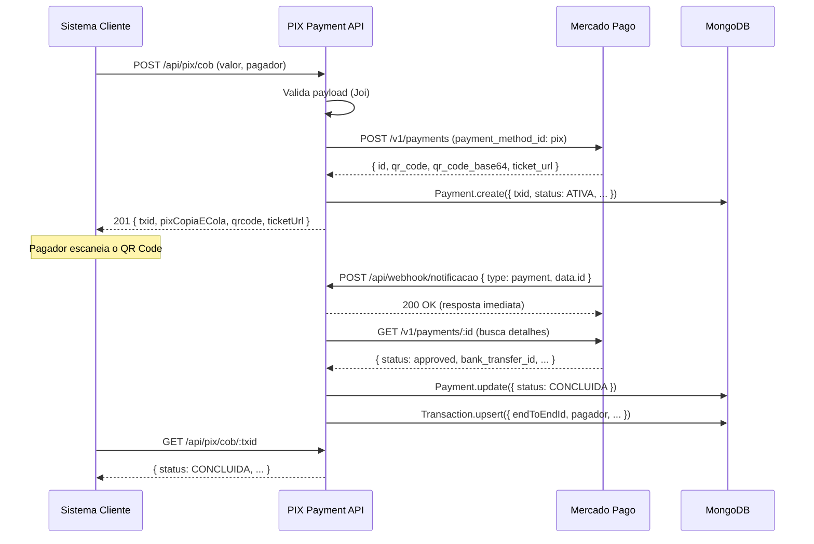

# 💸 PIX Payment API

<p align="center">
  
  
  
  
  
  
  
  
</p>

---

## 📖 Sobre o Projeto

A **PIX Payment API** é uma API RESTful construída em Node.js/Express que abstrai e centraliza todas as operações de pagamento instantâneo via **Pix**, integrando-se ao gateway **Mercado Pago** como provedor de serviços de pagamento (PSP).

### Problema Resolvido

Integrar diretamente com APIs de PSPs para Pix costuma ser verboso, repetitivo e sujeito a erros: gerenciamento de tokens OAuth2, tratamento de webhooks, persistência de cobranças e devoluções são responsabilidades que precisam ser implementadas em cada sistema. Esta API consolida toda essa lógica em um único serviço coeso, expondo contratos simples e bem documentados para qualquer sistema consumidor.

### O que ela faz

- Cria, consulta, lista e cancela **cobranças Pix** (QR Code dinâmico + Copia e Cola)
- Consulta e lista **pagamentos Pix recebidos**
- Processa **devoluções** totais e parciais
- Recebe e processa **notificações de webhook** do Mercado Pago de forma assíncrona
- Persiste o histórico completo de cobranças e transações no MongoDB

---

## 🛠 Tecnologias Utilizadas

### Linguagens & Runtime

| Tecnologia | Versão | Uso |
|---|---|---|
| Node.js | 20+ | Runtime principal |
| JavaScript (ES2022) | — | Linguagem de implementação |

### Frameworks & Bibliotecas

| Biblioteca | Versão | Finalidade |
|---|---|---|
| Express | 4.x | Framework HTTP |
| Mongoose | 8.x | ODM para MongoDB |
| Axios | 1.x | Cliente HTTP para o Mercado Pago |
| Joi | 17.x | Validação de schema dos payloads |
| jsonwebtoken | 9.x | Autenticação JWT da API interna |
| Helmet | 7.x | Headers de segurança HTTP |
| express-rate-limit | 7.x | Rate limiting por IP |
| Winston | 3.x | Logging estruturado |
| uuid | 14.x | Geração de IDs únicos |
| dotenv | 16.x | Gerenciamento de variáveis de ambiente |
| express-async-errors | 3.x | Propagação de erros assíncronos |

### Testes & Dev

| Ferramenta | Uso |
|---|---|
| Jest 29 | Test runner |
| Supertest | Testes de integração HTTP |
| Nodemon | Hot reload em desenvolvimento |

### Infraestrutura

| Ferramenta | Uso |
|---|---|
| MongoDB 7 | Banco de dados principal |
| Docker + Docker Compose | Containerização e orquestração local |

---

## 🏗 Arquitetura e Estrutura de Pastas

### Padrão Arquitetural

A API segue a **Arquitetura em Camadas (Layered Architecture)**, com responsabilidades bem separadas:

```
Requisição HTTP
     │
     ▼
┌─────────────┐
│  Middleware  │  auth, validate, rate-limit, helmet
└──────┬──────┘
       │
       ▼
┌─────────────┐
│  Controller  │  recebe req/res, delega ao Service
└──────┬──────┘
       │
       ▼
┌─────────────┐
│   Service    │  lógica de negócio + integração Mercado Pago
└──────┬──────┘
       │
       ▼
┌─────────────┐
│    Model     │  mongoose schemas, persistência MongoDB
└─────────────┘
```

### Diagrama de Fluxo — Ciclo de vida de um Pix



### Estrutura de Pastas

```
pix-payment-api/
│
├── src/
│   ├── config/
│   │   ├── database.js        # Conexão MongoDB via Mongoose
│   │   └── psp.js             # Axios client para o Mercado Pago
│   │
│   ├── controllers/
│   │   ├── pixController.js   # Handlers das rotas Pix
│   │   └── webhookController.js
│   │
│   ├── middlewares/
│   │   ├── auth.js            # Verificação de token JWT
│   │   ├── validate.js        # Validação de payload com Joi
│   │   └── errorHandler.js    # Tratamento centralizado de erros
│   │
│   ├── models/
│   │   ├── Payment.js         # Schema de cobranças Pix
│   │   └── Transaction.js     # Schema de Pix recebidos / devoluções
│   │
│   ├── routes/
│   │   ├── index.js           # Roteador raiz + health check
│   │   ├── pixRoutes.js       # /api/pix/*
│   │   └── webhookRoutes.js   # /api/webhook/*
│   │
│   ├── services/
│   │   ├── authService.js     # Gerenciamento do Access Token MP
│   │   ├── pixService.js      # Lógica de negócio Pix
│   │   └── webhookService.js  # Processamento de notificações MP
│   │
│   ├── utils/
│   │   └── logger.js          # Logger Winston
│   │
│   └── app.js                 # Configuração do Express
│
├── tests/
│   ├── unit/
│   │   ├── pixService.test.js
│   │   ├── webhookService.test.js
│   │   └── validate.test.js
│   └── integration/
│       ├── pix.test.js
│       └── webhook.test.js
│
├── Dockerfile
├── docker-compose.yml
├── jest.config.js
├── server.js                  # Entrypoint: conecta DB e sobe o servidor
├── .env.example
└── package.json
```

---

## ⚙️ Regras de Negócio e Funcionalidades

### Cobranças (Pix Out)

- Toda cobrança exige **valor positivo**, **e-mail do pagador** e **CPF ou CNPJ** (nunca os dois juntos)
- O campo `solicitacaoPagador` é opcional e limitado a **140 caracteres**
- A cobrança é criada no Mercado Pago como um pagamento com `payment_method_id: "pix"` e persiste no MongoDB com status `ATIVA`
- O cancelamento de uma cobrança altera o status para `REMOVIDA_PELO_USUARIO_RECEBEDOR` tanto no MP quanto no banco local

### Devoluções

- A devolução **parcial** exige o campo `valor` (positivo, até 2 casas decimais)
- A devolução **total** é acionada enviando o body sem o campo `valor`
- O MP identifica a devolução pelo `txid` (ID do pagamento no MP); não é necessário `e2eId` neste fluxo

### Webhook

- O endpoint `POST /api/webhook/notificacao` **não exige JWT** — a segurança é garantida pela validação do `MP_ACCESS_TOKEN` no processamento
- A resposta `200 OK` é enviada **imediatamente** ao MP, antes do processamento — garantindo que o MP não reenvie a notificação por timeout
- Notificações de tipo diferente de `"payment"` são ignoradas silenciosamente
- Ao receber um pagamento `approved`, a API busca os detalhes no MP e cria um registro em `Transaction` com o `endToEndId` (idempotente via `upsert`)

### Mapeamento de Status (Mercado Pago → API)

| Status MP | Status API |
|---|---|
| `pending` | `ATIVA` |
| `approved` | `CONCLUIDA` |
| `cancelled` | `REMOVIDA_PELO_USUARIO_RECEBEDOR` |
| `rejected` | `REMOVIDA_PELO_PSP` |

### Segurança

- Todos os endpoints (exceto `/notificacao`) requerem **Bearer JWT**
- **Rate limiting** de 100 requisições por 15 minutos por IP
- Headers de segurança via **Helmet** (CSP, HSTS, X-Frame-Options, etc.)
- Erros internos não expõem stack traces ao cliente em produção

---

## 🚀 Como Executar o Projeto

### Pré-requisitos

- [Node.js 20+](https://nodejs.org/)
- [Docker](https://www.docker.com/) e Docker Compose (para execução containerizada)
- Conta no [Mercado Pago Developers](https://www.mercadopago.com.br/developers) com credenciais de sandbox

---

### Opção 1 — Com Docker Compose (recomendado)

> Sobe a API e o MongoDB automaticamente, com hot reload.

**1. Clone o repositório e entre na pasta:**
```bash
git clone https://github.com/seu-usuario/pix-payment-api.git
cd pix-payment-api
```

**2. Copie e preencha as variáveis de ambiente:**
```bash
cp .env.example .env
```

Edite o `.env` com suas credenciais:

```env
MP_ACCESS_TOKEN=TEST-xxxxxxxxxxxxxxxxxxxxxxxxxxxx
JWT_SECRET=uma_chave_secreta_forte_aqui
```

**3. Suba os containers:**
```bash
docker compose up -d
```

> A API ficará disponível em `http://localhost:3000`.
> O MongoDB estará acessível em `localhost:27017`.
> O backend aguarda o healthcheck do MongoDB antes de iniciar.

---

### Opção 2 — Localmente (sem Docker)

**1. Instale as dependências:**
```bash
npm install
```

**2. Configure o ambiente:**
```bash
cp .env.example .env
# Edite o .env com suas credenciais e com MONGODB_URI=mongodb://localhost:27017/pix_api
```

**3. Inicie o MongoDB** (necessário ter instalado localmente ou via Docker isolado):
```bash
docker run -d -p 27017:27017 --name mongo mongo:7-jammy
```

**4. Inicie a aplicação em modo desenvolvimento:**
```bash
npm run dev
```

---

### Variáveis de Ambiente

| Variável | Obrigatória | Descrição |
|---|---|---|
| `PORT` | Não | Porta da aplicação (padrão: `3000`) |
| `NODE_ENV` | Não | Ambiente (`development` \| `production`) |
| `MONGODB_URI` | ✅ | String de conexão com o MongoDB |
| `JWT_SECRET` | ✅ | Chave secreta para assinar tokens JWT |
| `JWT_EXPIRES_IN` | Não | Expiração do token (padrão: `1d`) |
| `MP_ACCESS_TOKEN` | ✅ | Access Token do Mercado Pago |
| `MP_BASE_URL` | Não | URL base da API MP (padrão: `https://api.mercadopago.com`) |
| `WEBHOOK_URL` | Não | URL pública para receber notificações do MP |
| `RATE_LIMIT_WINDOW_MS` | Não | Janela do rate limit em ms (padrão: `900000`) |
| `RATE_LIMIT_MAX` | Não | Máx. de requisições por janela (padrão: `100`) |

---

### Comandos Docker úteis

```bash
# Subir com rebuild forçado
docker compose up -d --build

# Ver logs em tempo real
docker compose logs -f

# Ver logs só do backend
docker compose logs -f backend

# Parar os containers (mantém os dados)
docker compose down

# Parar e apagar todos os dados do MongoDB
docker compose down -v

# Status dos containers e healthchecks
docker compose ps
```

---

## 🧪 Testes

A suíte cobre **60 casos de teste** distribuídos entre testes unitários e de integração.

```bash
# Rodar todos os testes
npm test

# Rodar em modo watch (re-executa ao salvar)
npm run test:watch

# Gerar relatório de cobertura
npm run test:coverage
```

### Cobertura por arquivo

| Camada | Arquivo | Tipo |
|---|---|---|
| Service | `pixService.test.js` | Unitário |
| Service | `webhookService.test.js` | Unitário |
| Middleware | `validate.test.js` | Unitário |
| Routes + Controllers | `pix.test.js` | Integração |
| Routes + Controllers | `webhook.test.js` | Integração |

---

## 📄 Endpoints da API

> **Base URL:** `http://localhost:3000/api`
>
> Todos os endpoints (exceto `/webhook/notificacao` e `/health`) exigem o header:
> ```
> Authorization: Bearer <JWT_TOKEN>
> ```

---

### 🔵 Cobranças Pix

#### `POST /pix/cob` — Criar cobrança

```bash
curl -X POST http://localhost:3000/api/pix/cob \
  -H "Authorization: Bearer <token>" \
  -H "Content-Type: application/json" \
  -d '{
    "valor": 150.50,
    "solicitacaoPagador": "Pedido #1042",
    "pagador": {
      "email": "joao@email.com",
      "nome": "João Silva",
      "cpf": "12345678901"
    }
  }'
```

**Resposta `201`:**
```json
{
  "txid": "987654321",
  "valor": 150.50,
  "status": "ATIVA",
  "pixCopiaECola": "00020101021226...",
  "qrcode": "iVBORw0KGgoAAAANS...",
  "ticketUrl": "https://www.mercadopago.com.br/payments/987654321/ticket",
  "createdAt": "2024-01-15T10:00:00.000Z"
}
```

---

#### `GET /pix/cob` — Listar cobranças

```bash
curl http://localhost:3000/api/pix/cob?pagina=0&limite=10 \
  -H "Authorization: Bearer <token>"
```

---

#### `GET /pix/cob/:txid` — Consultar cobrança

```bash
curl http://localhost:3000/api/pix/cob/987654321 \
  -H "Authorization: Bearer <token>"
```

---

#### `DELETE /pix/cob/:txid` — Cancelar cobrança

```bash
curl -X DELETE http://localhost:3000/api/pix/cob/987654321 \
  -H "Authorization: Bearer <token>"
```

---

#### `POST /pix/cob/:txid/devolucao` — Solicitar devolução

```bash
# Devolução parcial
curl -X POST http://localhost:3000/api/pix/cob/987654321/devolucao \
  -H "Authorization: Bearer <token>" \
  -H "Content-Type: application/json" \
  -d '{ "valor": 50.00 }'

# Devolução total (body vazio)
curl -X POST http://localhost:3000/api/pix/cob/987654321/devolucao \
  -H "Authorization: Bearer <token>" \
  -d '{}'
```

---

### 🟢 Pix Recebidos

#### `GET /pix` — Listar Pix recebidos

```bash
curl http://localhost:3000/api/pix?pagina=0&limite=10 \
  -H "Authorization: Bearer <token>"
```

#### `GET /pix/:e2eId` — Consultar Pix pelo EndToEndId

```bash
curl http://localhost:3000/api/pix/E12345678 \
  -H "Authorization: Bearer <token>"
```

---

### 🟠 Webhook

#### `POST /webhook/notificacao` — Receber notificação do Mercado Pago

> Chamado automaticamente pelo Mercado Pago. Não requer JWT.

```json
{
  "action": "payment.updated",
  "api_version": "v1",
  "data": { "id": "987654321" },
  "type": "payment"
}
```

#### `PUT /webhook` — Configurar webhook

```bash
curl -X PUT http://localhost:3000/api/webhook \
  -H "Authorization: Bearer <token>"
```

#### `GET /webhook` — Consultar webhook cadastrado

```bash
curl http://localhost:3000/api/webhook \
  -H "Authorization: Bearer <token>"
```

---

### ⚪ Health Check

#### `GET /health`

```bash
curl http://localhost:3000/api/health
# { "status": "ok" }
```

---

### Tabela resumo de endpoints

| Método | Rota | Auth | Descrição |
|---|---|---|---|
| `POST` | `/pix/cob` | JWT | Criar cobrança Pix |
| `GET` | `/pix/cob` | JWT | Listar cobranças |
| `GET` | `/pix/cob/:txid` | JWT | Consultar cobrança por txid |
| `DELETE` | `/pix/cob/:txid` | JWT | Cancelar cobrança |
| `POST` | `/pix/cob/:txid/devolucao` | JWT | Solicitar devolução |
| `GET` | `/pix` | JWT | Listar Pix recebidos |
| `GET` | `/pix/:e2eId` | JWT | Consultar Pix por EndToEndId |
| `PUT` | `/webhook` | JWT | Configurar webhook no PSP |
| `GET` | `/webhook` | JWT | Consultar webhook cadastrado |
| `DELETE` | `/webhook` | JWT | Remover webhook |
| `POST` | `/webhook/notificacao` | — | Receber notificação do MP |
| `GET` | `/health` | — | Health check |

---

## 📝 Licença e Contribuição

### Licença

Distribuído sob a licença **MIT**. Consulte o arquivo `LICENSE` para mais detalhes.

### Contribuindo

1. Faça um **fork** do projeto
2. Crie uma branch para sua feature: `git checkout -b feat/minha-feature`
3. Faça commit das suas alterações: `git commit -m 'feat: adiciona minha feature'`
4. Faça push para a branch: `git push origin feat/minha-feature`
5. Abra um **Pull Request**

### Padrão de commits

Este projeto segue o [Conventional Commits](https://www.conventionalcommits.org/):

| Prefixo | Uso |
|---|---|
| `feat:` | Nova funcionalidade |
| `fix:` | Correção de bug |
| `docs:` | Alterações em documentação |
| `test:` | Adição ou correção de testes |
| `refactor:` | Refatoração sem mudança de comportamento |
| `chore:` | Tarefas de manutenção (deps, config) |

---

<p align="center">
  Feito com ☕ e Node.js
</p>
